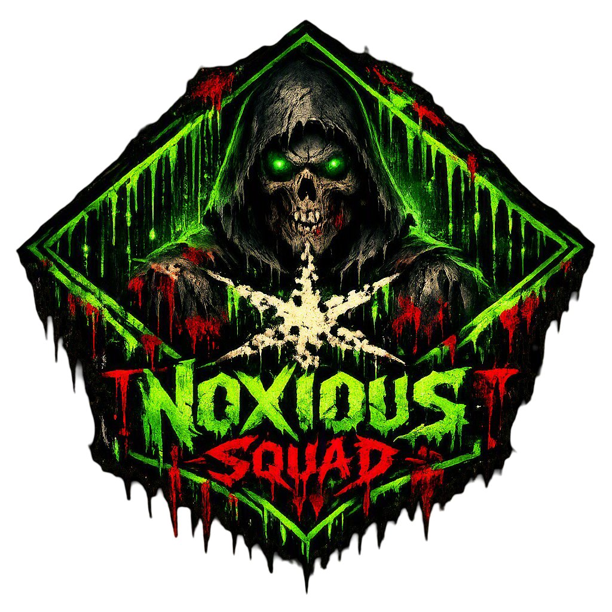
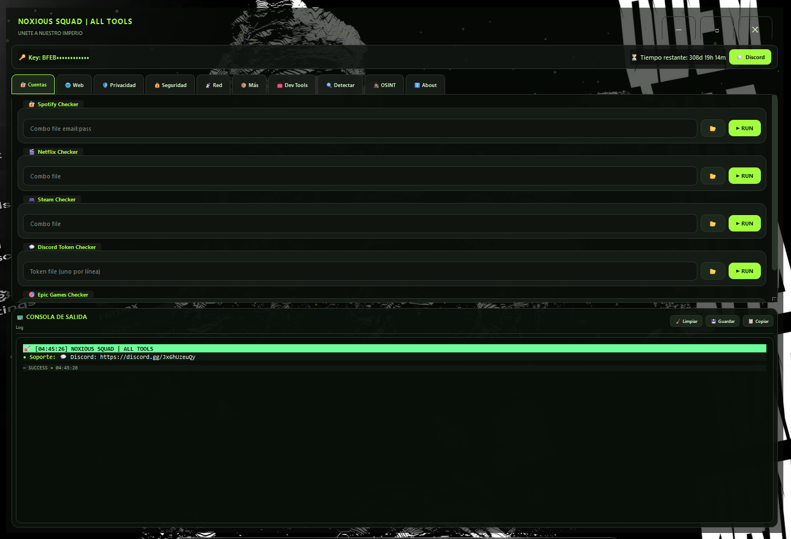

<p align="center">
  
</p>

<h1 align="center">NOXIOUS SQUAD | ALL TOOLS</h1>

<p align="center">
  <strong>Suite todo-en-uno con 50+ herramientas para seguridad, redes, privacidad y desarrollo.</strong>
</p>

<p align="center">
  <a href="https://discord.gg/Q6cknK8f3y"></a>
  
  
  
</p>

---

<p align="center">
  
</p>

---

## 📋 Índice

- [Descripción](#-descripción)
- [Características](#-características)
- [Estructura del Proyecto](#-estructura-del-proyecto)
- [Stack Técnico](#-stack-técnico)
- [Instalación](#-instalación)
- [Uso](#-uso)
- [Changelog](#-changelog)
- [Créditos](#-créditos)

---

## 📝 Descripción

**NOXIOUS SQUAD | ALL TOOLS** es una aplicación de escritorio construida en **Python + PySide6** que reúne más de **50 herramientas útiles** en una sola interfaz moderna, oscura y personalizable.

Fue diseñada pensando en profesionales de ciberseguridad, pentesters, administradores de redes y entusiastas que necesitan un toolkit rápido, completo y visualmente atractivo.

> **Versión actual:** `v2.0`  
> **Dev:** `nscp12`  
> **Discord:** [discord.gg/Q6cknK8f3y](https://discord.gg/Q6cknK8f3y)

---

## 🚀 Características

### 🔐 Cuentas
| Herramienta | Descripción |
|-------------|-------------|
| Spotify Checker | Verifica combos email:pass de Spotify |
| Netflix Checker | Verifica cuentas de Netflix |
| Steam Checker | Verifica logins de Steam |
| Discord Token Checker | Valida tokens y extrae info de usuario |
| Epic Games Checker | Verifica cuentas Epic Games |

### 🌐 Web
| Herramienta | Descripción |
|-------------|-------------|
| SQL Injection Scanner | Detecta inyecciones SQL con 7 payloads |
| XSS Scanner | Detecta XSS reflejado |
| Admin Finder | Busca 30+ rutas de paneles admin |
| Directory Brute Force | Fuzzing de directorios con wordlist |
| Subdomain Scanner | Enumera subdominios vía DNS |

### 🛡️ Privacidad
| Herramienta | Descripción |
|-------------|-------------|
| Fingerprint | Genera huella digital del sistema/navegador |
| Browser Info | Analiza User-Agent y detecta navegador/OS |
| DNS Leak Test | Detecta fugas de DNS |
| WebRTC Leak | Detecta exposición de IPs privadas vía WebRTC |
| Privacy Checkup | Score de privacidad, detección VPN/datacenter |
| Torrent Leak | Verifica IP expuesta en clientes torrent |

### 🔒 Seguridad
| Herramienta | Descripción |
|-------------|-------------|
| Email Leak | Verifica si un email aparece en brechas |
| Password Generator | Genera contraseñas seguras con entropía |
| Port Scanner | Escaneo TCP real con fallback local |
| Blacklist | Verifica IP en 12 listas negras DNSBL |
| Security Headers | Analiza cabeceras de seguridad HTTP |
| Email Auth | Verifica SPF/DKIM/DMARC de dominios |

### 📡 Red
| Herramienta | Descripción |
|-------------|-------------|
| My IP | Muestra IP pública, geolocalización e ISP |
| IP Lookup | Geolocalización e ISP de cualquier IP |
| ASN Lookup | Información de ASN por IP/AS/org |
| DNS Lookup | Consulta registros A/AAAA/MX/NS/TXT/CNAME |
| Speed Test | Mide ping, descarga y subida |
| Reverse DNS | Resuelve PTR/hostname de una IP |
| Traceroute | Traza ruta hasta destino |
| WHOIS / RDAP | Información de registro de dominios |

### 📦 Más / IP Tools
| Herramienta | Descripción |
|-------------|-------------|
| Subnet Calc | Calcula máscara, red, broadcast, hosts |
| CIDR Calc | Convierte CIDR a rango detallado |
| IP Range to CIDR | Convierte rango de IPs a lista CIDR |
| IP in CIDR | Verifica si una IP está dentro de un CIDR |
| Special IP | Analiza si es privada/loopback/multicast |
| Down? | Verifica si un sitio está caído |
| Bulk Lookup | Consulta hasta 50 IPs en lote |
| Bingo | Bingo divertido de seguridad |

### 🧰 Dev Tools
| Herramienta | Descripción |
|-------------|-------------|
| Base64 | Codifica/decodifica Base64 y URLSafe |
| JSON | Formatea, minifica y valida JSON |
| Hash | Genera MD5/SHA1/SHA256/SHA512/BLAKE2b |
| URL Encode/Decode | Codifica y decodifica URLs |
| JWT Decoder | Decodifica JWT sin verificar firma |
| Epoch Converter | Convierte epoch ↔ fecha |
| UUID Tool | Genera y valida UUID v1/v3/v4/v5 |
| QR Code | Genera códigos QR y guarda PNG |
| Email Headers Parser | Analiza cabeceras de emails |
| IP Converter | Convierte IP entre decimal/hex/bin/octal |
| IPv6 Expand/Compress | Expande y comprime direcciones IPv6 |
| MAC Tool | Genera, valida y busca vendor de MAC |

### 🔍 Detectar
| Herramienta | Descripción |
|-------------|-------------|
| Screen | Detecta resolución, DPI y orientación |
| User Agent | Muestra y parsea tu User-Agent |
| Headers | Inspecciona cabeceras HTTP enviadas |
| Proxy Check | Detecta proxy/VPN y headers sospechosos |
| Info | Información de sistema, CPU, RAM, disco |
| Timezone | Zona horaria, offset y hora local/UTC |
| Language | Idioma del sistema y Accept-Language |
| Location | Ubicación aproximada vía IP |
| SSL/TLS | Analiza certificado, cipher y expiración |

### 🕵️ OSINT
| Herramienta | Descripción |
|-------------|-------------|
| IP Info | Información detallada de IP |
| Email Breach Check | Brechas de emails |
| Username Search | Busca usuario en 15 plataformas |
| News | Noticias de seguridad |
| Combo Sorter | Separa combos por keyword |
| Extractor | Extrae emails, combos, IPs, URLs, teléfonos |

---

## 🏗️ Estructura del Proyecto

```
NOXIOUS ALL TOOLS/
│
├── main.py              # Aplicación principal (PySide6 GUI + lógica)
├── requirements.txt     # Dependencias de Python
├── install.bat          # Script de instalación y ejecución (Windows)
├── TOOLS.txt            # Documentación de herramientas incluidas
├── README.md            # Este archivo
│
├── assets/
│   ├── logo.png         # Logo oficial de NOXIOUS SQUAD
│   └── screenshot.png   # Captura de pantalla de la interfaz
│
└── __pycache__/         # Caché de Python
```

### Arquitectura Interna (`main.py`)

El archivo `main.py` está organizado en clases Python independientes, una por herramienta, siguiendo un diseño modular:

| Componente | Descripción |
|------------|-------------|
| `SecureClient` | Cliente HTTP con reintentos automáticos, headers por defecto y fallback a APIs públicas |
| `Utils` | Utilidades comunes (logs, formateo, validaciones) |
| `*Checker` / `*Tool` | Clases individuales para cada herramienta (50+ clases) |
| `FloatingDots` | Widget de animación de partículas para el fondo visual |
| `TitleBar` | Barra de título personalizada sin bordes nativos |
| `MethodPackGUI` | Ventana principal que ensambla las pestañas, consola de salida y barra de estado |

La interfaz está construida con **PySide6 (Qt)** con las siguientes características:
- **Tema oscuro personalizado** con paleta de colores verde neón (`#A3FF3D`) sobre fondo negro.
- **Barra de título propia** sin marco de Windows, con botones de minimizar, maximizar y cerrar.
- **Consola de salida** embebida con formato HTML, timestamps y niveles de log (success, error, warning, info).
- **Pestañas categorizadas** con scroll independiente por sección.
- **Ejecución en hilos** (`threading.Thread`) para no bloquear la UI durante escaneos.

---

## 🛠️ Stack Técnico

| Tecnología | Uso |
|------------|-----|
| **Python 3.11+** | Lenguaje principal |
| **PySide6 6.7+** | GUI nativa de escritorio (Qt6) |
| **Requests** | Cliente HTTP para APIs y escaneos web |
| **BeautifulSoup4 + lxml** | Parsing HTML en escáneres web |
| **dnspython** | Resolución DNS local |
| **psutil** | Información de sistema (CPU, RAM, disco) |
| **qrcode + Pillow** | Generación de códigos QR |
| **cryptography + pyjwt** | Análisis de JWT y certificados SSL/TLS |

---

## 📥 Instalación

### Requisitos
- Windows 10/11
- Python 3.11 o superior
- Conexión a Internet (para APIs externas)

### Método rápido (Windows)
1. Clona o descarga el repositorio.
2. Ejecuta `install.bat`:
   ```bat
   install.bat
   ```
   Esto instalará las dependencias y lanzará la aplicación automáticamente.

### Método manual
```bash
# Instalar dependencias
pip install -r requirements.txt

# Ejecutar
python main.py
```

---

## 🎮 Uso

1. Ejecuta `main.py` o `install.bat`.
2. La aplicación abre directamente la ventana principal (sin login).
3. Navega por las pestañas superiores para acceder a cada categoría de herramientas.
4. Completa los campos de entrada y presiona **RUN**.
5. Los resultados aparecen en la **Consola de Salida** inferior con colores y emojis.

> 💡 **Tip:** Puedes limpiar, guardar o copiar el log desde los botones de la consola.

---

## 🔄 Changelog

### v2.0 — Última versión
- ✅ **Actualizado enlace de Discord** a [discord.gg/Q6cknK8f3y](https://discord.gg/Q6cknK8f3y).
- ✅ **Dev actualizado** a `nscp12`.
- ✅ **Barra de estado rediseñada** — muestra versión y autor en lugar de key y tiempo restante.
- ✅ **README completo** con logo, screenshot y documentación técnica.

---

## 🙌 Créditos

- **Developer:** `nscp12`
- **Comunidad:** [NOXIOUS SQUAD en Discord](https://discord.gg/Q6cknK8f3y)

<p align="center">
  
</p>

<p align="center"><strong>Únete a nuestro imperio.</strong></p>
